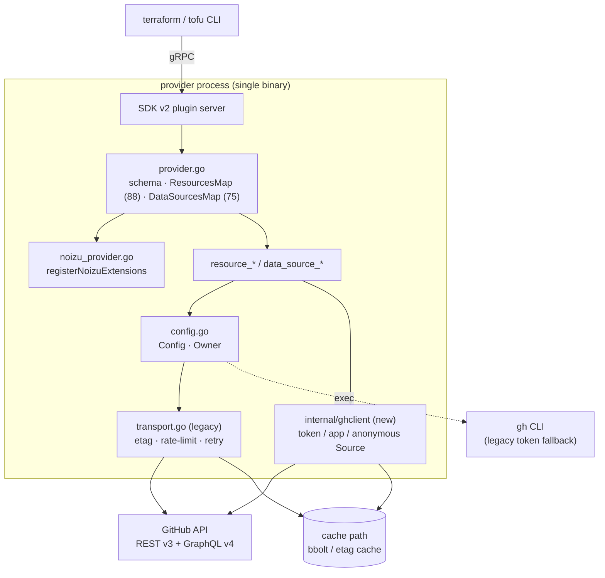

# Project Architecture

<!-- 〚📁:d39eb92c-4528-559a-8d36-ee5e89f21182〛 Project Architecture :: Architecture overview: plugin lifecycle, auth chain, dual client stacks, extension layer. -->

## Overview

This repository is a **Terraform/OpenTofu provider plugin** — a single Go binary (`main.go` → `plugin.Serve`) that Terraform launches as a gRPC subprocess. It translates HCL into GitHub REST/GraphQL API calls and back. There is no server, database, or long-running service: every architectural concern is in-process (schema, clients, transport) or in the boundary to GitHub's API.

This tree is Noizu's fork (`noizu-forks/terraform-provider-github`) of `integrations/terraform-provider-github`, cut from release tag `v6.13.0`. `main` mirrors upstream untouched; `develop` carries a thin **extension layer** for resources upstream does not ship. The fork's governing rule is that upstream files stay merge-clean (see [arch/noizu-extension-layer.md](arch/noizu-extension-layer.md)).

## System Diagram

## Core Components

| Component | Purpose | Location |
|---|---|---|
| Plugin entry | `plugin.Serve` with `ProviderAddr registry.terraform.io/integrations/github`; version/commit injected by GoReleaser | `main.go` |
| Provider schema | Provider config attributes, resource/data-source registries, `Configure` auth chain | `github/provider.go` |
| Resource layer | 88 resources / 75 data sources; context-aware CRUD, importers, state upgraders | `github/resource_*.go`, `github/data_source_*.go` |
| Noizu extension layer | Empty-by-default maps merged into the provider, collision-panicking | `github/noizu_provider.go` |
| Legacy client | `Config`/`Owner` + transport stack (etag, rate-limit, retry, preview headers) | `github/config.go`, `github/transport.go` |
| New client | `Source` abstraction (token / app / anonymous), library-based conditional requests + rate limiting | `internal/ghclient/` |
| Utilities | Composite ID build/parse, validators, team/repo resolution, diff funcs | `github/util*.go` |

→ *Components ↔ directories: see [PROJ-LAYOUT.md](PROJ-LAYOUT.md)*

## Authentication and Clients

Two client stacks coexist, selected by provider argument `legacy_client` (default `true`).

**Auth resolution (legacy path):** `app_auth` block or `GITHUB_APP_*` → app installation token exchange; else `token` attribute / `GITHUB_TOKEN`; else `gh auth token --hostname <host>` via `tokenFromGHCLI`; else anonymous (read-only public access, stricter limits). `owner` is inferred from the token's user when unset. In the new-client path the `gh` CLI fallback does not run and `owner` is required for authenticated use.

→ *See [arch/auth-and-clients.md](arch/auth-and-clients.md) for the chain, app JWT handling, and the two stacks*

## Transport and Rate Limiting

Legacy: an `http.RoundTripper` chain — `etagTransport` (conditional requests, optional persistent cache), `RateLimitTransport` (read/write delays, abuse-limit backoff), Terraform logging, preview-header injection, and `RetryTransport` for `max_retries` on `retryable_errors`. New: `github-conditional-http-transport` + `go-github-ratelimit` wired in `internal/ghclient`, with a bbolt cache and a semaphore bounding concurrency.

→ *See [arch/transport.md](arch/transport.md)*

## Request Lifecycle (plan → apply)

1. Terraform starts the binary; `NewProvider` builds the schema and calls `registerNoizuExtensions`, which panics on any name collision with upstream.
2. `Configure` resolves credentials into `Config`, then builds clients into `Owner` (`v3client` REST, `v4client` GraphQL).
3. Each resource's Read/Create/Update/Delete makes targeted API calls; 404 in Read clears the ID so Terraform drops it from state.
4. Import functions set only the attributes Read needs, then Terraform re-calls Read.

## Testing and Build

- Unit tests run without credentials; acceptance tests (`TF_ACC`) hit live GitHub and are gated by mode-skip helpers (anonymous / individual / organization / enterprise). **Agents run unit tests only.**
- CI workflows exist in the tree but are disabled on the fork. Local contract: `make test` (unit), `make build` (implies `lintcheck`), `make generatedocs` for `docs/`.
- Consumption during development is via `scripts/noizu/build-dev-override.sh` + `TF_CLI_CONFIG_FILE`, not a registry publish.

→ *See [arch/testing-and-build.md](arch/testing-and-build.md)*

## Key Decisions

- **One resource = one API entity; API-only, never local git** — keeps state predictable (`DECISIONS.md`).
- **Explicit authentication**, no silent multi-source probing beyond the documented chain.
- **SDK v2 + `terraform-plugin-testing`** with `ConfigStateChecks`/`ConfigPlanChecks`, `StateUpgraders` over `MigrateState`, `tflog` over `log`.
- **Fork isolation**: exactly one upstream touch (`NewProvider`'s return expression); everything else new `noizu_*.go` files, so upstream release merges stay near-conflict-free.
- **Two client stacks** are transitional: the new client is opt-in (`legacy_client = false`), the legacy one remains the default.

→ *Full rationale: [DECISIONS.md](../DECISIONS.md) and [arch/decisions.md](arch/decisions.md)*
