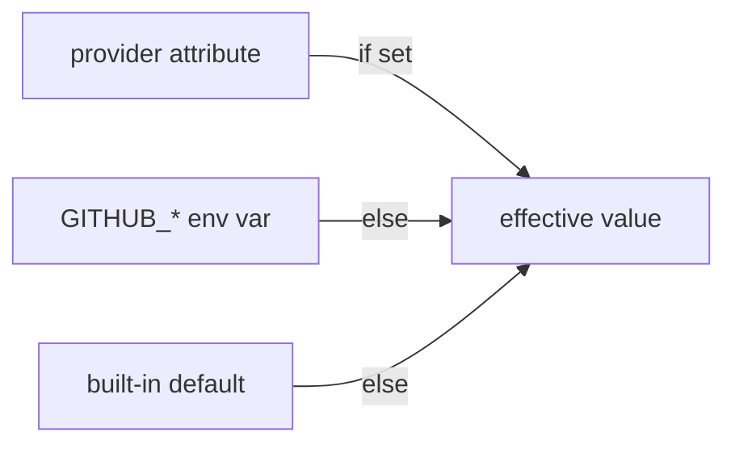

# Project Schema

There is **no relational database** in this repository — no SQL, no migrations, no ORM. Per the schema-doc scope table, this document covers the structured data that does exist:

| Data kind | Where | Section |
|---|---|---|
| Config schema (provider block) | `github/provider.go` | [Provider Configuration](#provider-configuration) |
| Interface schema (resource/data-source contracts) | `github/resource_*.go`, `github/data_source_*.go` | [Resource and Data Source Schema](#resource-and-data-source-schema) |
| State key schema (Terraform IDs) | `github/util.go` | [State ID Schema](#state-id-schema) |
| On-disk data (cache, tfrc, pointer store) | `cache_path`, `~/.config/opentofu/`, `.meta/` | [On-Disk Data](#on-disk-data) |
| Test fixture naming | `github/*_test.go` | [Fixture Conventions](#fixture-conventions) |

ERD sections are intentionally omitted: no relational schema exists.

## Provider Configuration

The provider block is the only config the binary reads; every attribute also has an env-var fallback (first non-empty wins, attribute over env).

| Attribute | Type | Default | Env var | Notes |
|---|---|---|---|---|
| `base_url` | string | `https://api.github.com/` | `GITHUB_BASE_URL` | GHES/GHEC detection via host |
| `owner` | string | — | `GITHUB_OWNER` | Required for app auth and for authenticated new-client use |
| `organization` | string | — | `GITHUB_ORGANIZATION` | **Deprecated** — use `owner` |
| `token` | string | — | `GITHUB_TOKEN` | PAT/OAuth token |
| `app_auth` | list(max 1) | — | — | Block below |
| `app_auth.id` | string, required | — | `GITHUB_APP_ID` | Also read directly from env by `getAppAuth` |
| `app_auth.installation_id` | string, required | — | `GITHUB_APP_INSTALLATION_ID` | |
| `app_auth.pem_file` | string, required, **sensitive** | — | `GITHUB_APP_PEM_FILE` | Literal `\n` sequences unescaped |
| `read_delay_ms` | int ≥ 0 | `0` | — | Ignored when `legacy_client=false` |
| `write_delay_ms` | int ≥ 0 | `1000` | — | Applies to GraphQL too (all POSTs) |
| `retry_delay_ms` | int ≥ 0 | `1000` | — | Used when `max_retries > 0` |
| `retryable_errors` | list(int) | `500,502,503,504` | — | |
| `max_retries` | int ≥ 0 | `3` | — | |
| `max_per_page` | int ≥ 1 | `100` | `GITHUB_MAX_PER_PAGE` | Pagination size |
| `parallel_requests` | bool | `false` | — | Legacy-only knob |
| `insecure` | bool | `false` | — | **Deprecated and unused** — not applied anywhere |
| `legacy_client` | bool | `true` | `GITHUB_LEGACY_CLIENT` | Selects the client stack |
| `cache_path` | string | `""` | `GITHUB_CACHE_PATH` | Empty ⇒ per-process cache only |

Precedence:

Two behaviours worth knowing: `token` and `app_auth` are **not** mutually exclusive in the schema (`ConflictsWith` is commented out with a `TODO: Enable as part of v7`), so a config may set both — app auth wins in legacy resolution; and an `app_auth` block present but incomplete is a hard error rather than a silent fallback to `token`.

## Resource and Data Source Schema

88 managed resources and 75 data sources are registered. Each is a `schema.Schema` map; generated user-facing docs live in `docs/resources/` and `docs/data-sources/`. Domain breakdown of **registered names**:

| Domain | Resources | Data sources |
|---|---|---|
| repository | 19 | 15 |
| actions (secrets/variables/permissions/runners/OIDC) | 18 | 13 |
| organization | 13 | 16 |
| team | 6 | 1 |
| enterprise | 6 | 1 |
| codespaces | 4 | 6 |
| dependabot | 4 | 4 |
| branch / branch protection | 4 | 2 |
| user | 3 | 2 |
| issue | 3 | 1 |
| project (Classic — deprecated) | 2 | — |
| app | 2 | 2 |
| release | 1 | 2 |
| membership | 1 | 1 |
| workflow, emu | 1 each | — |
| noizu extensions | 0 | 0 |

Schema conventions enforced by review (`ARCHITECTURE.md`): every field has `Description`; computed values are also `Optional` when the server defaults them; secrets use `Sensitive`; behaviour changes use `ForceNew`; validation uses `ValidateDiagFunc`; cardinality limits use `MaxItems`/`MinItems`.

## State ID Schema

Terraform IDs are colon-separated composite strings.

| Form | Build | Parse |
|---|---|---|
| single | `d.SetId(name)` | — |
| 2–4 parts | `buildID(p1, p2, …)` → `p1:p2` | `parseID2` / `parseID3` / `parseID4` |
| part containing `:` | `buildID(escapeIDPart(p), …)` — `:` → `??` | `unescapeIDPart` |
| derived | `buildChecksumID(parts)` (MD5 of joined parts) | recomputed on read |

Rules: only the **final** part may contain an unescaped separator (`buildID` rejects otherwise); `parseID` splits with `SplitN(id, ":", count)` so the last part keeps any remaining colons; `buildTwoPartID`/`buildThreePartID` are deprecated.

## On-Disk Data

| Path | Shape | Written by | Lifecycle |
|---|---|---|---|
| `<cache_path>/terraform-provider-github/<cacheRef>/cache.db` | bbolt store of conditional-request entries | new client (`ghclient.createCacheStore`) | persistent; dir `0700`, file `0600` |
| temp dir (`*`) | bbolt store | new client when `cache_path` unset | per process |
| `~/.config/opentofu/github-fork.tfrc` | HCL `provider_installation` with `dev_overrides` | `scripts/noizu/build-dev-override.sh` | rewritten per build |
| `~/.local/share/opentofu/github-fork/terraform-provider-github` | Go plugin binary | same script | replaced per build |
| `.meta/pointers.yaml` | doc-pointer records keyed by UUID | `doc-pointers build --write` | committed; never hand-edited |

No key-value service, message queue, or data fixture corpus exists. The cache store holds response bodies, i.e. repository/org metadata — never credentials.

## Fixture Conventions

- Acceptance resources are named `tf-acc-test-<random>`; `make sweep` deletes leftovers by that prefix (`SWEEP=repositories,teams`).
- Deploy-key tests generate throwaway RSA keys into `test-fixtures/` at run time (`ssh-keygen`); keys are not committed.
- Random suffix helper: `acctest.RandString(testRandomIDLength)` (`github/acc_helpers_test.go`).

→ *Where the loaders and schema definitions live: [PROJ-LAYOUT.md](PROJ-LAYOUT.md), [layout/github.md](layout/github.md)*
