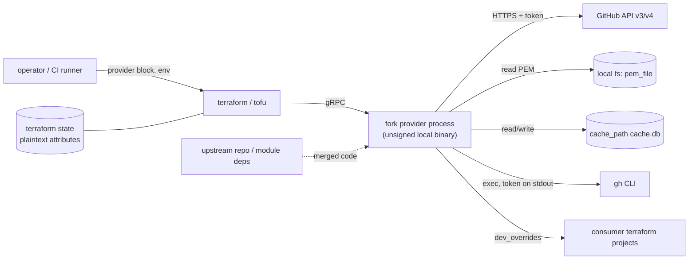

# Threat Model

<!-- 〚📁:f132676e-c5ba-5650-840c-35a7b2a558ff〛 Threat Model :: Living threat model: attack surface, credential paths, supply-chain exposure, register. -->

## Overview

The crown jewels are twofold: **GitHub credentials** (PAT/OAuth token, GitHub App private key) and the **managed GitHub estate** — the repos, teams, org settings and secrets Terraform is authorised to create, mutate and destroy. A defect in this provider does not merely mis-report; `tofu apply` deletes real repositories, and a leaked credential grants whatever scope the operator's token carries.

Trust boundaries that matter: Terraform CLI ↔ provider process (same host, gRPC); provider ↔ GitHub API (TLS, remote, authoritative); provider ↔ local filesystem (PEM, cache, tfrc, state); provider ↔ `gh` CLI subprocess (credential inheritance); and — specific to this tree — **local fork binary ↔ consumer projects** (a `dev_overrides` binary shadowing the trusted registry provider with no signature check).

This tree is a fork. It inherits upstream's threat profile for the provider logic, and adds its own supply-chain exposure: CI is disabled, nothing is published, and the artifact consumed is an unsigned local build.

## Attack Surface

→ *See [threats/attack-surface.md](threats/attack-surface.md) for the full enumeration*

## Vulnerability Register

| ID | Severity | STRIDE | Component | Status |
|---|---|---|---|---|
| T-001 | High | Tampering / Spoofing | Unsigned locally built fork injected via `dev_overrides` | Partial — scoped to `TF_CLI_CONFIG_FILE`, sha256 printed, no provenance |
| T-002 | High | Information disclosure | `token` attribute is not `Sensitive` in the provider schema | Open — only `app_auth.pem_file` is masked |
| T-003 | Medium | Elevation / Info disclosure | `gh auth token` fallback inherits operator's CLI credential; `GH_PATH`/`PATH` resolved binary | Partial — debug-logged, errors swallowed |
| T-004 | Medium | Information disclosure | Persistent response cache stores API bodies unencrypted | Partial — dir `0700`, file `0600` |
| T-005 | Medium | Information disclosure | App private key via env var / config can leak through process listings and CI logs | Partial — schema marks `pem_file` sensitive |
| T-006 | High | Tampering (destructive) | Wrong `owner`/`base_url` or stale state destroys real GitHub resources | Accepted — mitigated only by `prevent_destroy` in consumer configs |
| T-007 | Medium | Repudiation | All actions attributed to one shared token; no per-run actor | Accepted |
| T-008 | Low | Denial of service | Retry/parallelism can amplify API abuse limits | Mitigated — `max_retries` 3, delays default on, `parallel_requests` off |
| T-009 | Medium | Supply chain | No CI/CodeQL or dependency alerting on the fork | Open — `go.sum` pinning is the only control |
| T-010 | Low | Spoofing | `base_url` can point at an attacker host, sending the token there | Accepted — required for GHES |
| T-011 | Medium | Information disclosure | Terraform state holds plaintext attributes (secrets, keys) | Accepted — consumer-managed backend |
| T-012 | Low | Elevation | A resource name collision could shadow a trusted resource | Mitigated — `mergeNoizuMaps` panics at provider construction |

## Mitigation Coverage

2 mitigated · 5 partial · 3 open (T-002, T-009 and the residual gaps under T-001/T-006) · 3 accepted.

The two open items are cheap and worth closing: mark `token` sensitive (T-002) and either enable a minimal lint/dependency scan or state explicitly that advisory review is manual (T-009).

→ *Credential-path controls: [threats/credentials.md](threats/credentials.md)*
→ *Build/supply-chain controls: [threats/supply-chain.md](threats/supply-chain.md)*

## Residual Risk

- **Destructive authority is inherent.** T-006 cannot be fixed in the provider: it is authorised to delete what the token can delete. Consumers must use state locking, `prevent_destroy`, and review plans.
- **Fork builds are unverifiable.** There is no attestation path for this binary. Mitigation is procedural: build locally from a reviewed commit, consume only via `TF_CLI_CONFIG_FILE`, never install globally.
- **`gh` CLI fallback is a credential-widening convenience.** It exists upstream for operator ergonomics; if it is undesirable, pin `token`/`app_auth` explicitly so the fallback never fires.
- **No CI means no automated regression gate.** Local `make build` (which runs `lintcheck`) and `make test` are the contract; nothing enforces them on push.
